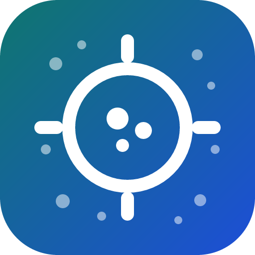

<!-- mcp-name: io.github.076923/vecscope -->

<div align="center" markdown="1">



**English** · [한국어](https://github.com/076923/vecscope/blob/main/docs/ko/README.md)

# vecscope

### Embedding space evidence for agents.

**Before an agent trusts a vector index, let it see the space it is searching.**

[](https://pypi.org/project/vecscope/)
[](https://pypi.org/project/vecscope/)
[](https://pepy.tech/projects/vecscope)<br>
[](https://github.com/076923/vecscope/actions/workflows/ci.yml)
[](https://076923.github.io/vecscope/)
[](https://github.com/076923/vecscope/blob/main/LICENSE)

[Quick start](#quick-start) · [What it measures](#what-vecscope-measures) · [Use with an agent](#use-with-an-agent) · [Use in CI](#use-in-ci) · [Usage](https://076923.github.io/vecscope/usage/) · [FAQ](#faq) · [Documentation](#documentation)

<code>pip install vecscope</code>

</div>

---

Agents build RAG pipelines, semantic search and recommendation retrieval every day, but they
cannot see the embedding space they are searching.

When retrieval goes wrong it rarely looks like a bug. It looks like:

- "the same three chunks come back for everything"
- "every score is 0.8-something"
- "top-k is full of copies"
- "brute force finds it and HNSW does not"

Each of those failures has a known, deterministic diagnostic in the literature. `vecscope`
turns them into one command and one JSON:

- measurements
- `ok` / `warn` / `fail` verdicts
- an explanation an agent can act on

It runs locally on NumPy, needs no model or network, and reports the same numbers every time.

`vecscope` diagnoses the **vector search implementation**: the geometry the model produced,
the hygiene of the corpus, the distance metric, the index and the query pipeline.

It does not measure relevance. Whether the right documents come back for a question needs
labeled queries, and a clean audit is evidence that search is not sabotaging retrieval, not
proof that retrieval is good.

## Quick start

### 1. Install

```bash
pip install vecscope
```

### 2. Get a file of embeddings

`vecscope` reads a file with one embedding vector per row: the `(n, dim)` array a model's
`encode` returns, saved as `.npy`, `.parquet`, `.jsonl`, `.json` or `.csv`
([all formats](https://076923.github.io/vecscope/usage/#input-formats)).

```python
import numpy as np
embeddings = model.encode(texts)          # shape (n, dim), e.g. (3000, 128)
np.save("embeddings.npy", embeddings)
```

No embeddings at hand? Generate three synthetic matrices (healthy, anisotropic, collapsed):

```bash
python -c "import urllib.request as u; u.urlretrieve('https://raw.githubusercontent.com/076923/vecscope/main/examples/make_examples.py', 'make_examples.py')"
python make_examples.py
```

### 3. Run the audit

```bash
vecscope audit embeddings.npy
```

```text
vecscope x.y.z  n=3000 dim=128 k=10  verdict=FAIL
  [ok  ] hubness                skewness=1.1661  (ok < 2, warn >= 2, fail >= 4)
                               k-occurrence skewness 1.17; top 1% of items take 3.9% of all neighbor slots (max N_k=51, expected 10).
  [WARN] antihubs               antihub_excess=0.0523  (ok < 0.05, warn >= 0.05, fail >= 0.2)
                               5.2% of items are never anyone's neighbor (random data at k=10 would give 0.0%); the excess is unreachable through k-NN retrieval.
                               try: inspect a sample of never-retrieved items; drop empty inputs, then apply the hubness fix
  [FAIL] anisotropy             mean_random_cosine=0.8732  (ok < 0.5, warn >= 0.5, fail >= 0.85)
                               random pairs have mean cosine 0.873 (isotropic ~0); mean unit vector has norm 0.93; centering would bring the cosine to -0.000.
                               try: subtract the corpus mean vector and re-normalize, applying the same transform to queries; details.mean_random_cosine_after_centering shows the expected result
  [ok  ] effective_rank         effective_rank_ratio=0.5407  (ok >= 0.1, warn < 0.1, fail < 0.05)
                               effective rank 69.2 of 128 attainable (128 dims; 54.1%); low values mean most dimensions carry nothing.
  [ok  ] collapse               near_duplicate_ratio=0.0000  (ok < 0.02, warn >= 0.02, fail >= 0.1)
                               0.0% of items have a neighbor with cosine >= 0.99 or an exact copy (exact duplicates 0.0%); no row has a near-duplicate.
  [ok  ] rogue_dimensions       top1_dim_variance_ratio=1.3070  (ok < 10, warn >= 10, fail >= 50)
                               dimension 94 alone holds 1.0% of variance, 1.3x the uniform share of 0.78%; top 3 dims hold 3.0%. Rogue dimensions dominate cosine.
  [ok  ] norms                  norm_cv=0.0000  (ok < 0.1, warn >= 0.1, fail >= 0.3)
                               vector norms vary with CV 0.000 (median 1.000, range 1.000-1.000); 0.00% are zero vectors. Unequal norms bias inner-product search toward long vectors.
  [ok  ] metric_mismatch        topk_overlap=1.0000  (ok >= 0.9, warn < 0.9, fail < 0.7)
                               cosine and inner-product top-10 share 100.0% of neighbors; 100.0% of items get identical lists. Low overlap means the index metric changes the results.
  [ok  ] distance_concentration contrast_over_noise=2.2784  (ok >= 1.4, warn < 1.4, fail < 1.1)
                               on 3000 rows a random item is 3.27x farther than the nearest neighbor (random distance 0.127); isotropic noise at 128-d and the same rows would give 1.44x, so the contrast is 2.28x that of noise. On all rows the contrast is 3.27x (median NN distance 0.039). Near 1.0 means distances carry no signal.
  [ok  ] outliers               outlier_ratio=0.0030  (ok < 0.01, warn >= 0.01, fail >= 0.05)
                               0.30% of items have no neighbor within cosine distance 0.050 (median 0.039); see details.sample_ids. Typically junk, empty or foreign-language content.
  [ok  ] connectivity           island_ratio=0.0000  (ok < 0.01, warn >= 0.01, fail >= 0.1)
                               0.00% of items sit in 0 small island(s) of the k-NN graph (fewer than 15 items; 60 components in total). Graph-based ANN (HNSW) attaches islands to the wrong region or never reaches them.
```

### 4. Read the result

- The first line gives the overall `verdict`: the worst verdict among the findings.
- Each finding shows the measured value, the range that would be `ok`, and a sentence saying
  what the number means for retrieval. Findings that are not `ok` add a `try:` line with the
  smallest change to test first.
- The exit code is `1` on `FAIL`, so the same command works as a CI gate.
- Add `--json` to get the same evidence as JSON for an agent or a script.

## What vecscope measures

| Finding | Metric | ok | warn | fail | What it means when it fails |
| --- | --- | --- | --- | --- | --- |
| `hubness` | skewness of the k-occurrence distribution | < 2.0 | 2.0 to 4.0 | ≥ 4.0 | a few items appear in everyone's k-NN list and will top every query |
| `antihubs` | share of items never retrieved as a neighbor, above the random baseline e^-k | < 5% | 5 to 20% | ≥ 20% | part of the corpus is unreachable through k-NN |
| `anisotropy` | mean cosine of random pairs | < 0.85 | 0.85 to 0.95 | ≥ 0.95 | vectors crowd into a narrow cone, so scores compress into a band; good retrievers sit well below this without losing nDCG, so only extreme values are flagged |
| `effective_rank` | participation ratio of the covariance spectrum / attainable rank (dim, or rows − 1 when rows do not exceed dims) | ≥ 0.10 | 0.05 to 0.10 | < 0.05 | most dimensions carry nothing |
| `collapse` | share of rows with a neighbor at cosine ≥ 0.99 or an exact copy (zero vectors included); details give the duplicate groups and sample pairs | < 2% | 2 to 10% | ≥ 10% | top-k is spent on copies of the same item |
| `ann_recall` | recall@k of ANN neighbors vs exact k-NN, counted by distance so that exact ties (duplicates) are interchangeable; the tie slack is 1e-6 + 2e-6 x distance, two to three times float32 rounding | ≥ 0.95 | 0.85 to 0.95 | < 0.85 | the index, not the model, is losing results |
| `rogue_dimensions` | variance of the largest dimension as a multiple of the uniform 1/dim share | < 10x | 10 to 50x | ≥ 50x | a few coordinates decide every cosine score |
| `norms` | coefficient of variation of vector norms | < 0.10 | 0.10 to 0.30 | ≥ 0.30 | inner-product search favors long vectors; zero vectors are reported too |
| `metric_mismatch` | top-k overlap between cosine and inner product | ≥ 0.90 | 0.70 to 0.90 | < 0.70 | the index metric changes which results come back |
| `distance_concentration` | relative contrast (random distance / nearest-neighbor distance) divided by that of isotropic noise at the same dimension and row count | ≥ 1.4 | 1.1 to 1.4 | < 1.1 | the nearest neighbor is barely closer than a random item; 1.0 is pure noise |
| `outliers` | share of items with an abnormally far nearest neighbor | < 1% | 1 to 5% | ≥ 5% | junk, empty or foreign items; ids are listed in `details` |
| `connectivity` | share of items in small k-NN graph islands | < 1% | 1 to 10% | ≥ 10% | self-contained groups too small to be clusters; HNSW attaches them badly or never reaches them |
| `query_gap` | median query-to-corpus nearest distance divided by the median corpus-to-corpus nearest distance | < 2.6 | 2.6 to 3.0 | ≥ 3.0 | queries and corpus do not share a space, typically queries embedded by a different model (5 to 10). Pipelines that reproduce published nDCG@10 sit at 0.94 to 2.52; a missing query prefix does not reliably move it |
| `query_shift` | share of queries farther from the corpus than the median + 3 MAD of a reference query set (needs a baseline) | < 20% | 20 to 30% | ≥ 30% | the query pipeline moved since the reference: another model or version, or traffic on topics the corpus does not cover. Healthy query sets score 0 to 9% |
| `ood_queries` | deprecated, read `query_gap`: share of queries farther from the corpus than 99% of corpus items are from each other | < 50% | 50 to 80% | ≥ 80% | same question as `query_gap`, but it counts the normal distance between short queries and long passages too (good models score 0 to 65% on BEIR) and false-alarmed on 4 of 18 reproduced pipelines |
| `query_hubness` | skewness of corpus k-occurrence over query results | < 4.0 | 4.0 to 10.0 | ≥ 10.0 | the same few items answer most queries; the value tracks nDCG@10 across models (Spearman −0.5 to −0.9), wrong-language models score 11 to 30. It grows with corpus size: good English models score 1.5 to 3.4 up to 26k documents and 4.0 to 4.8 on 58k, so on large corpora compare against a baseline |

Every finding in the JSON carries its `healthy_range`, `warn_at` and `fail_at`, plus a `details`
block with the raw numbers. For `anisotropy` that block includes the cosine the same vectors
would have after centering, so the agent can see whether centering alone fixes the problem.

Some findings appear only when you pass their inputs:

- `ann_recall`: an ANN neighbor file with `--ann`
- `query_gap`, `query_hubness` and `ood_queries`: query embeddings with `--queries`
- `query_shift`: query embeddings, and `--baseline` also pointing at an earlier audit run with
  queries

Each finding also carries `likely_causes`, `suggested_action` and `verify_by`. They are
hypotheses, not prescriptions:

- apply the smallest change
- re-audit
- compare retrieval on real queries before adopting it

The [agent skill](https://github.com/076923/vecscope/blob/main/.agents/skills/vecscope/SKILL.md) spells out
that loop.

### Thresholds

The thresholds are defaults:

- calibrated on [seven public models](https://076923.github.io/vecscope/quality/#real-embeddings)
- re-checked against 19 models on nine labeled datasets in two languages
  ([verification](https://github.com/076923/vecscope/blob/main/docs/verification.md))

They are a starting point for diagnosis, not a universal quality bar. Embedding spaces
differ by model, language, domain and dimensionality, so a `warn` on a good model is normal
and a clean audit does not guarantee good search.

Override any pair per run, or derive them from your own data with
[`vecscope calibrate`](https://076923.github.io/vecscope/quality/#calibrating-thresholds-to-your-domain):

```bash
vecscope audit vectors.npy --thresholds my_thresholds.json
# my_thresholds.json: {"anisotropy.mean_random_cosine": [0.4, 0.7], "hubness.skewness": [2.5, 5]}
```

The keys are listed in `src/vecscope/evidence.py` (`THRESHOLDS`) and echoed in every JSON
result under `thresholds`.

## Use with an agent

`vecscope` ships an MCP server with four read-only tools: `audit_embeddings`, `sweep_index`,
`compare_embeddings` and `describe_findings`. Register it with any MCP client:

```bash
pip install vecscope
claude mcp add vecscope -- vecscope-mcp --allow-dir /data/embeddings     # Claude Code
```

Then ask:

```text
Audit the embeddings in data/chunks.npy before we tune the retriever, and tell me
which finding to fix first.
```

The server reads only the directories named with `--allow-dir` (without it, the directory it
was started in). [Use with an agent](https://076923.github.io/vecscope/mcp/) has the setup for Cursor, Codex and
VS Code, the tools and their responses, what the server may read, and the clients it was
tested with. The [agent skill](https://github.com/076923/vecscope/blob/main/.agents/skills/vecscope/SKILL.md) tells the agent what to do about each verdict.

## Use in CI

`vecscope audit` exits 1 on `FAIL`. Commit a reviewed `--json` run as the baseline, and the
build fails only when a finding gets worse:

```bash
vecscope audit embeddings.npy --json > baseline.json          # once, reviewed and committed
vecscope audit embeddings.npy --baseline baseline.json        # on every rebuild
```

On GitHub the same gate is an Action:

```yaml
- uses: 076923/vecscope@v0
  with:
    path: embeddings.npy
    baseline: baseline.json
    sample: "0"
```

[Use in CI](https://076923.github.io/vecscope/ci/) covers tolerances for slow drift, which rule failed a run, and the
Action's inputs and outputs.

## FAQ

<details>
<summary><strong>Does it send my vectors anywhere?</strong></summary>

No. `vecscope` computes everything with NumPy on your machine. It never loads a model or opens
a network connection.

</details>

<details>
<summary><strong>How large a matrix can it handle?</strong></summary>

Exact k-NN is quadratic in the number of rows. By default `vecscope` audits a seeded random
sample of 100,000 rows when the input is larger, and says so in the output (`sampled: true`,
`n_total`).

A sampled result describes the sample, not the whole corpus: rare clusters, small islands and
a handful of outliers can be missed.

Row ids in `details` (`sample_ids`, `sample_pairs`, the cluster report) always refer to rows
of the input file, also when sampled. Use `--sample 0` to audit everything; see
[performance](https://076923.github.io/vecscope/performance/#performance) for what that costs.

To see how much the sample itself moves a number, pass `--sample-repeats 3` (MCP:
`sample_repeats`). vecscope then audits three independent seeded samples and attaches
`value_range` (minimum to maximum across samples) and `verdict_stable` to every finding, and
lists `unstable_findings` at the top level.

A finding whose verdict flips between samples should be read as borderline, not as a property
of the corpus. The cost is three audits.

`value_range` is the spread between samples, not an interval that contains the full-corpus
value: hubness is a lower bound on every sample, and even a very stable finding can sit a
little outside the range of three samples.

Not every finding means the same thing on a sample: hubness is understated, outliers
overcounted, islands mostly invisible. The [performance](https://076923.github.io/vecscope/performance/#performance) table says what each
finding can stand for and which verdicts a sampled audit marks `inconclusive`.

</details>

<details>
<summary><strong>My production model fails the anisotropy check. Is the model broken?</strong></summary>

Not necessarily. Many popular text embedding models are strongly anisotropic by construction.

The finding tells you that raw cosine scores are compressed into a narrow band; centering or
whitening the vectors, or re-ranking, usually restores discrimination. The `details` block
reports the cosine after centering so you can see whether that is enough. The verdict is
evidence for the agent, not a grade for the model.

</details>

<details>
<summary><strong>Which agents can use it?</strong></summary>

Any agent that supports local MCP servers, and any agent that can run a shell command and read
JSON. The skill file describes both paths.

</details>

## Documentation

- [Documentation site](https://076923.github.io/vecscope/): this README and the pages below, searchable
- [Usage](https://076923.github.io/vecscope/usage/): queries and clusters, the index sweep, comparing two embeddings,
  vector stores, incremental audits, the library, CLI options and input formats
- [Use with an agent](https://076923.github.io/vecscope/mcp/): MCP setup per client, tools and responses, what the
  server may read, tested clients
- [Use in CI](https://076923.github.io/vecscope/ci/): baselines, tolerances, the gate and the GitHub Action
- [Retrieval quality and thresholds](https://076923.github.io/vecscope/quality/): the fix order, real embeddings, whether
  the findings predict nDCG, calibrating thresholds to your domain
- [Performance](https://076923.github.io/vecscope/performance/): audit time and memory, sampled audits, how vecscope works
- [Agent skill](https://github.com/076923/vecscope/blob/main/.agents/skills/vecscope/SKILL.md): when to run the audit and what to do with each verdict
- [Retrieval-quality tables](https://github.com/076923/vecscope/blob/main/docs/retrieval_quality.md): every finding against nDCG@10 on labeled data
- [Verification](https://github.com/076923/vecscope/blob/main/docs/verification.md): exactness, recall scoring, the sampling claims, the query findings, interventions, agent integration, and 19 models on 9 labeled datasets
- [Agent cases](https://github.com/076923/vecscope/blob/main/docs/agent_case.md): an agent finding and fixing two ingestion faults, and a mis-tuned IVF index, over MCP, with the tool calls and numbers
- [Examples](https://github.com/076923/vecscope/tree/main/examples/): synthetic matrices, the calibration script and the retrieval-quality study
- [Changelog](https://github.com/076923/vecscope/blob/main/CHANGELOG.md)

## Contributing

Issues and pull requests are welcome. See [CONTRIBUTING.md](https://github.com/076923/vecscope/blob/main/CONTRIBUTING.md) for how to run
the tests and what a good change looks like. Security reports go through
[SECURITY.md](https://github.com/076923/vecscope/blob/main/SECURITY.md).

## License

[MIT](https://github.com/076923/vecscope/blob/main/LICENSE)
