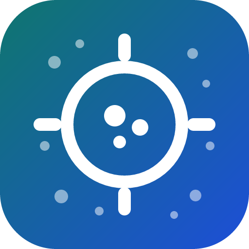

<div align="center" markdown="1">



[English](https://github.com/076923/vecscope/blob/main/README.md) · **한국어**

# vecscope

### 에이전트를 위한 임베딩 공간 진단 도구

**에이전트가 벡터 인덱스를 신뢰하기 전에, 검색하는 공간을 직접 점검하게 하세요.**

[](https://pypi.org/project/vecscope/)
[](https://pypi.org/project/vecscope/)
[](https://pepy.tech/projects/vecscope)<br>
[](https://github.com/076923/vecscope/actions/workflows/ci.yml)
[](https://076923.github.io/vecscope/)
[](https://github.com/076923/vecscope/blob/main/LICENSE)

[빠른 시작](#빠른-시작) · [진단 항목](#진단-항목) · [에이전트와 함께 사용](#에이전트와-함께-사용) · [CI에서 사용](#ci에서-사용) · [사용법](usage.md) · [FAQ](#faq) · [문서](#문서)

<code>pip install vecscope</code>

</div>

---

에이전트는 검색 증강 생성(RAG), 의미 기반 검색(semantic search), 추천 검색을 쉽게 구축하지만,
정작 자신이 검색하는 임베딩 공간은 들여다보지 못합니다.

그러므로 검색 품질 문제는 버그처럼 드러나지 않고 다음과 같은 증상으로만 나타납니다.

- 무엇을 물어도 같은 청크(chunk) 몇 개가 돌아옵니다.
- 유사도 점수가 전부 0.8 근처에 몰려 있습니다.
- 상위 k개가 중복 항목으로 채워집니다.
- 전수 탐색(brute-force)으로는 검색되는 항목이 HNSW에서는 빠집니다.

이런 증상은 정립된 진단 지표로 측정할 수 있습니다. `vecscope`는 그 지표들을
명령 하나, JSON 하나로 묶었습니다. 결과에는 다음이 함께 들어 있습니다.

- 측정값
- `ok` / `warn` / `fail` 판정
- 에이전트가 다음 조치를 정할 때 참고할 설명

NumPy만 활용하여 로컬에서 동작하고, 모델이나 네트워크 연결이 필요 없으며, 같은 입력에는
언제나 같은 결과를 출력합니다.

`vecscope`가 진단하는 대상은 **벡터 검색 구현**입니다. 모델이 만든 공간의 기하, 코퍼스의
상태, 거리 척도, 인덱스, 질의 파이프라인이 여기에 해당합니다.

검색 결과의 관련성은 측정하지 않습니다. 질문에 맞는 문서가 실제로 검색되는지는 정답이 있는
질의로 따로 평가해야 하며, 감사 결과가 모두 `ok`라는 것은 검색을 방해하는 요인이 없다는
근거이지 검색 품질이 좋다는 증명은 아닙니다.

## 빠른 시작

### 1. 설치

```bash
pip install vecscope
```

### 2. 임베딩 파일 준비

`vecscope`는 행마다 임베딩 벡터가 하나씩 담긴 파일을 읽습니다. 모델의 `encode`가 반환하는
`(n, dim)` 배열을 `.npy`, `.parquet`, `.jsonl`, `.json`, `.csv` 중 하나로 저장하면 됩니다
([전체 형식](usage.md#입력-형식)).

```python
import numpy as np
embeddings = model.encode(texts)          # 형태 (n, dim), 예: (3000, 128)
np.save("embeddings.npy", embeddings)
```

준비된 임베딩이 없다면 합성 행렬 세 개(정상, 비등방성, 중복)를 만들어 시험해 볼 수 있습니다.

```bash
python -c "import urllib.request as u; u.urlretrieve('https://raw.githubusercontent.com/076923/vecscope/main/examples/make_examples.py', 'make_examples.py')"
python make_examples.py
```

### 3. 감사 실행

```bash
vecscope audit embeddings.npy
```

```text
vecscope x.y.z  n=3000 dim=128 k=10  verdict=FAIL
  [ok  ] hubness                skewness=1.1661  (ok < 2, warn >= 2, fail >= 4)
                               k-occurrence skewness 1.17; top 1% of items take 3.9% of all neighbor slots (max N_k=51, expected 10).
  [WARN] antihubs               antihub_excess=0.0523  (ok < 0.05, warn >= 0.05, fail >= 0.2)
                               5.2% of items are never anyone's neighbor (random data at k=10 would give 0.0%); the excess is unreachable through k-NN retrieval.
                               try: inspect a sample of never-retrieved items; drop empty inputs, then apply the hubness fix
  [FAIL] anisotropy             mean_random_cosine=0.8732  (ok < 0.5, warn >= 0.5, fail >= 0.85)
                               random pairs have mean cosine 0.873 (isotropic ~0); mean unit vector has norm 0.93; centering would bring the cosine to -0.000.
                               try: subtract the corpus mean vector and re-normalize, applying the same transform to queries; details.mean_random_cosine_after_centering shows the expected result
  [ok  ] effective_rank         effective_rank_ratio=0.5407  (ok >= 0.1, warn < 0.1, fail < 0.05)
                               effective rank 69.2 of 128 attainable (128 dims; 54.1%); low values mean most dimensions carry nothing.
  [ok  ] collapse               near_duplicate_ratio=0.0000  (ok < 0.02, warn >= 0.02, fail >= 0.1)
                               0.0% of items have a neighbor with cosine >= 0.99 or an exact copy (exact duplicates 0.0%); no row has a near-duplicate.
  [ok  ] rogue_dimensions       top1_dim_variance_ratio=1.3070  (ok < 10, warn >= 10, fail >= 50)
                               dimension 94 alone holds 1.0% of variance, 1.3x the uniform share of 0.78%; top 3 dims hold 3.0%. Rogue dimensions dominate cosine.
  [ok  ] norms                  norm_cv=0.0000  (ok < 0.1, warn >= 0.1, fail >= 0.3)
                               vector norms vary with CV 0.000 (median 1.000, range 1.000-1.000); 0.00% are zero vectors. Unequal norms bias inner-product search toward long vectors.
  [ok  ] metric_mismatch        topk_overlap=1.0000  (ok >= 0.9, warn < 0.9, fail < 0.7)
                               cosine and inner-product top-10 share 100.0% of neighbors; 100.0% of items get identical lists. Low overlap means the index metric changes the results.
  [ok  ] distance_concentration contrast_over_noise=2.2784  (ok >= 1.4, warn < 1.4, fail < 1.1)
                               on 3000 rows a random item is 3.27x farther than the nearest neighbor (random distance 0.127); isotropic noise at 128-d and the same rows would give 1.44x, so the contrast is 2.28x that of noise. On all rows the contrast is 3.27x (median NN distance 0.039). Near 1.0 means distances carry no signal.
  [ok  ] outliers               outlier_ratio=0.0030  (ok < 0.01, warn >= 0.01, fail >= 0.05)
                               0.30% of items have no neighbor within cosine distance 0.050 (median 0.039); see details.sample_ids. Typically junk, empty or foreign-language content.
  [ok  ] connectivity           island_ratio=0.0000  (ok < 0.01, warn >= 0.01, fail >= 0.1)
                               0.00% of items sit in 0 small island(s) of the k-NN graph (fewer than 15 items; 60 components in total). Graph-based ANN (HNSW) attaches islands to the wrong region or never reaches them.
```

### 4. 결과 읽는 법

- 첫 줄의 `verdict`가 전체 판정입니다. 항목별 판정 가운데 가장 낮은 등급을 따릅니다.
- 항목마다 측정값, `ok`로 판정되는 범위, 그 수치가 검색에서 무엇을 뜻하는지 설명하는 문장이
  차례대로 출력됩니다. `ok`가 아닌 항목에는 먼저 시도할 변경을 적은 `try:` 줄이 붙습니다.
- 판정이 `FAIL`이면 종료 코드가 1이므로 같은 명령을 CI 게이트로 쓸 수 있습니다.
- `--json`을 붙이면 같은 내용을 에이전트나 스크립트가 읽기 쉬운 JSON으로 출력합니다.

## 진단 항목

| 항목 | 지표 | ok | warn | fail | fail 판정의 의미 |
| --- | --- | --- | --- | --- | --- |
| `hubness` | k-출현 빈도(k-occurrence) 분포의 왜도(skewness) | < 2.0 | 2.0~4.0 | ≥ 4.0 | 소수의 항목이 대부분의 질의에서 k-최근접 이웃(k-NN)에 포함되어 검색 결과 상위를 독점한다. |
| `antihubs` | 어떤 질의에서도 이웃으로 선택되지 않는 항목의 비율에서 무작위 기준선 e^-k를 뺀 값 | < 5% | 5~20% | ≥ 20% | 코퍼스(corpus)의 일부에 k-NN 검색으로 도달할 수 없다. |
| `anisotropy` | 무작위 쌍의 평균 코사인 유사도 | < 0.85 | 0.85~0.95 | ≥ 0.95 | 벡터가 좁은 원뿔 영역에 몰려 점수가 좁은 구간에 압축된다. 검색 성능이 좋은 모델도 이보다 훨씬 낮은 값에서 nDCG 손실 없이 동작하므로 극단적인 값만 표시한다. |
| `effective_rank` | 공분산 스펙트럼의 참여 비율(participation ratio)을 도달 가능한 랭크(차원 수, 행 수가 차원 수 이하이면 행 수 − 1)로 나눈 값 | ≥ 0.10 | 0.05~0.10 | < 0.05 | 대부분의 차원이 정보를 담고 있지 않다. |
| `collapse` | 코사인 유사도 0.99 이상인 이웃이 있거나 정확히 같은 행이 있는(0 벡터 포함) 근접 중복(near-duplicate) 비율. details에 중복 묶음과 예시 쌍이 있다. | < 2% | 2~10% | ≥ 10% | 상위 k개가 동일 항목의 복사본으로 채워진다. |
| `ann_recall` | 정확한 k-NN 대비 근사 최근접 이웃(ANN) 인덱스의 재현율(recall@k). 거리 기준으로 세므로 완전 동점인 중복 항목은 서로 바꿔 세며, 동점 허용 오차는 1e-6 + 2e-6 × 거리(float32 반올림 오차의 2~3배)다 | ≥ 0.95 | 0.85~0.95 | < 0.85 | 모델이 아니라 인덱스에서 결과가 누락되고 있다. |
| `rogue_dimensions` | 분산이 가장 큰 차원의 분산이 균등 분배(1/dim) 대비 몇 배인지 | < 10배 | 10~50배 | ≥ 50배 | 소수의 좌표가 모든 코사인 점수를 결정한다. |
| `norms` | 벡터 길이(norm)의 변동 계수(coefficient of variation) | < 0.10 | 0.10~0.30 | ≥ 0.30 | 내적(inner product) 검색이 긴 벡터를 우대한다. 길이가 0인 벡터의 비율도 함께 보고한다. |
| `metric_mismatch` | 코사인과 내적의 상위 k개 겹침 비율 | ≥ 0.90 | 0.70~0.90 | < 0.70 | 인덱스의 거리 척도(metric)에 따라 반환 결과가 달라진다. |
| `distance_concentration` | 상대 대비(무작위 거리 / 최근접 이웃 거리)를 같은 차원·같은 행 수의 등방성 잡음이 갖는 값으로 나눈 비율 | ≥ 1.4 | 1.1~1.4 | < 1.1 | 최근접 이웃이 무작위 항목과 거의 같은 거리에 있다. 1.0이면 순수 잡음이다. |
| `outliers` | 최근접 이웃이 비정상적으로 먼 이상치(outlier) 항목의 비율 | < 1% | 1~5% | ≥ 5% | 불량 항목, 빈 문서, 다른 언어로 된 항목으로 id를 `details`에 나열한다. |
| `connectivity` | k-NN 그래프의 작은 섬에 속한 항목 비율 | < 1% | 1~10% | ≥ 10% | 군집(cluster)으로 보기에는 너무 작은 고립 집단. HNSW가 잘못 연결하거나 도달하지 못한다. |
| `query_gap` | 질의→코퍼스 최근접 거리의 중앙값을 코퍼스→코퍼스 최근접 거리의 중앙값으로 나눈 값 | < 2.6 | 2.6~3.0 | ≥ 3.0 | 질의와 코퍼스가 같은 공간에 있지 않다. 대표적인 원인은 질의를 다른 모델로 임베딩한 경우로, 5~10이 나온다. 공개 nDCG@10을 재현한 파이프라인은 0.94~2.52이고, 질의 접두어 누락으로는 이 값이 일정하게 움직이지 않는다. |
| `query_shift` | 기준 질의 집합의 중앙값 + 3 MAD보다 코퍼스에서 먼 질의의 비율(기준선 필요) | < 20% | 20~30% | ≥ 30% | 기준 시점 이후 질의 파이프라인이 바뀌었다. 다른 모델이나 버전, 또는 코퍼스가 다루지 않는 주제의 질의가 원인이다. 정상 질의 집합은 0~9%다. |
| `ood_queries` | 지원 중단, `query_gap`을 볼 것: 코퍼스 항목 간 거리의 99% 지점보다 코퍼스에서 더 먼 질의의 비율 | < 50% | 50~80% | ≥ 80% | `query_gap`과 같은 것을 묻지만 짧은 질의와 긴 문서 사이의 정상적인 거리까지 세므로(좋은 모델도 BEIR에서 0~65%) 공개 nDCG를 재현한 파이프라인 18개 중 4개를 잘못 경고했다. |
| `query_hubness` | 질의 결과에서 코퍼스 항목의 k-출현 빈도 왜도 | < 4.0 | 4.0~10.0 | ≥ 10.0 | 소수의 항목이 대부분의 질의에 답한다. 이 값은 모델 간 nDCG@10과 꾸준히 상관하며(Spearman −0.5~−0.9), 언어가 맞지 않는 모델은 11~30이 나온다. 코퍼스가 클수록 커져서 좋은 영어 모델도 문서 2.6만 개까지는 1.5~3.4, 5.8만 개에서는 4.0~4.8이므로 큰 코퍼스에서는 기준선과 비교한다. |

JSON의 각 항목에는 `healthy_range`, `warn_at`, `fail_at`과 세부 수치를 담은 `details`가
들어 있습니다. `anisotropy`의 `details`에는 같은 벡터를 중심화했을 때의 코사인 값까지 있어서,
중심화만으로 해결되는 문제인지 에이전트가 바로 판단할 수 있습니다.

일부 항목은 해당 입력을 넘겼을 때만 나타납니다.

- `ann_recall`: `--ann`으로 ANN 이웃 파일을 넘겼을 때
- `query_gap`, `query_hubness`, `ood_queries`: `--queries`로 질의 임베딩을 넘겼을 때
- `query_shift`: 여기에 더해 `--baseline`이 질의와 함께 감사한 이전 실행을 가리킬 때

각 항목에는 `likely_causes`(가능한 원인), `suggested_action`(먼저 시도할 조치),
`verify_by`(확인 방법)도 함께 들어 있습니다. 이는 처방이 아니라 가설입니다.

- 가장 작은 변경을 적용합니다.
- 다시 감사합니다.
- 실제 질의로 검색 결과를 전후 비교하고 나서 채택합니다.

[에이전트 스킬](https://github.com/076923/vecscope/blob/main/.agents/skills/vecscope/SKILL.md)에 이 절차가 정리되어 있습니다.

### 임곗값

임곗값은 다음과 같이 정한 기본값입니다.

- [공개 모델 7개](quality.md#실제-임베딩-검증)로 보정
- 두 언어의 라벨 데이터세트 9개에서 모델 19종으로 다시 확인([검증 결과](verification.md))

진단의 출발점이지 보편적인 품질 기준은 아닙니다. 임베딩 공간은 모델, 언어, 도메인, 차원 수에
따라 달라지므로 좋은 모델에서도 `warn`은 흔하고, 감사 결과가 모두 `ok`라고 해서 검색 품질이
보장되지는 않습니다.

실행할 때마다 원하는 쌍을 덮어쓰거나, [`vecscope calibrate`](quality.md#임곗값을-도메인에-맞추기)로
자신의 데이터에서 구할 수 있습니다.

```bash
vecscope audit vectors.npy --thresholds my_thresholds.json
# my_thresholds.json: {"anisotropy.mean_random_cosine": [0.4, 0.7], "hubness.skewness": [2.5, 5]}
```

키 목록은 `src/vecscope/evidence.py`의 `THRESHOLDS`에 있고, 모든 JSON 결과의 `thresholds`
필드에도 그대로 실립니다.

## 에이전트와 함께 사용

`vecscope`에는 읽기 전용 도구 네 개(`audit_embeddings`, `sweep_index`, `compare_embeddings`,
`describe_findings`)를 제공하는 MCP 서버가 들어 있습니다. MCP 클라이언트에 다음과 같이 등록합니다.

```bash
pip install vecscope
claude mcp add vecscope -- vecscope-mcp --allow-dir /data/embeddings     # Claude Code
```

그다음 이렇게 요청합니다.

```text
검색기를 튜닝하기 전에 data/chunks.npy 임베딩을 감사하고, 먼저 조치할 항목을 알려줘.
```

서버는 `--allow-dir`로 지정한 디렉터리만 읽습니다(지정하지 않으면 서버를 시작한 디렉터리).
Cursor, Codex, VS Code 설정, 도구와 응답, 서버가 읽을 수 있는 범위, 테스트한 클라이언트는
[에이전트와 함께 사용](mcp.md)에 있습니다. 판정별로 에이전트가 할 일은
[에이전트 스킬](https://github.com/076923/vecscope/blob/main/.agents/skills/vecscope/SKILL.md)에 있습니다.

## CI에서 사용

`vecscope audit`은 `FAIL`이면 종료 코드 1을 돌려줍니다. 검토를 마친 `--json` 실행 결과를
기준선으로 커밋해 두면, 진단 항목이 나빠질 때만 빌드가 실패합니다.

```bash
vecscope audit embeddings.npy --json > baseline.json          # 처음 한 번, 검토 후 커밋
vecscope audit embeddings.npy --baseline baseline.json        # 다시 만들 때마다
```

GitHub에서는 같은 게이트를 Action으로 쓸 수 있습니다.

```yaml
- uses: 076923/vecscope@v0
  with:
    path: embeddings.npy
    baseline: baseline.json
    sample: "0"
```

서서히 나빠지는 변화를 잡는 허용치, 어느 규칙이 실행을 실패시켰는지, Action의 입력과 출력은
[CI에서 사용](ci.md)에 있습니다.

## FAQ

<details>
<summary><strong>벡터가 외부로 전송됩니까?</strong></summary>

아니요. 모든 계산은 NumPy로 로컬에서 이루어집니다. 모델을 내려받거나 네트워크
연결을 하지 않습니다.

</details>

<details>
<summary><strong>얼마나 큰 행렬까지 처리할 수 있습니까?</strong></summary>

정확한 k-NN은 행 수의 제곱에 비례하는 비용이 듭니다. 그래서 기본 설정에서는 입력이 10만 행을
넘으면 고정 시드로 뽑은 표본만 감사하고, 그 사실을 출력에 표시합니다(`sampled: true`,
`n_total`).

표본 결과는 표본에 대한 설명이지 전체 코퍼스에 대한 확정 판정이 아니므로, 드문 군집이나 작은
섬, 소수의 이상치는 놓칠 수 있습니다.

`details`의 행 번호(`sample_ids`, `sample_pairs`, 군집 보고서)는 표본을 뽑았을 때도 항상 입력
파일의 행 번호입니다. 전체 행을 감사하려면 `--sample 0`을 지정하십시오. 비용은 [성능](performance.md#성능)
절을 참고하십시오.

표본 자체가 수치를 얼마나 흔드는지 보려면 `--sample-repeats 3`(MCP: `sample_repeats`)을
지정하십시오. 그러면 서로 다른 시드로 뽑은 표본 3개를 감사해 모든 항목에 `value_range`(표본
간 최솟값~최댓값)와 `verdict_stable`을 붙이고, 최상위에 `unstable_findings` 목록을 둡니다.

표본에 따라 판정이 바뀌는 항목은 코퍼스의 성질이 아니라 경계선에 걸친 값으로 읽어야 합니다.
비용은 감사 3회분입니다.

`value_range`는 표본 사이의 흩어짐을 보여 줄 뿐, 전체 코퍼스 값이
그 안에 있다고 보장하지는 않습니다. hubness는 어느 표본에서나 전체보다 낮게 나오고, 아주
안정적인 항목도 전체 값이 표본 3개의 범위를 조금 벗어날 수 있습니다.

표본에서 모든 항목이 같은 의미를 갖지는 않습니다. hubness는 낮게, outliers는 많게 잡히고
섬은 대부분 보이지 않습니다. 항목별로 표본이 무엇을 말해 주는지, 어떤 판정이
`inconclusive`로 표시되는지는 [성능](performance.md#성능) 절의 표에 있습니다.

</details>

<details>
<summary><strong>운영 중인 모델이 anisotropy에서 fail 판정을 받았습니다. 모델에 문제가 있는 것입니까?</strong></summary>

꼭 그렇지는 않습니다. 널리 쓰이는 텍스트 임베딩 모델 상당수가 구조적으로 강한 비등방성을
띱니다.

이 판정은 코사인 점수가 좁은 구간에 몰려 변별력이 떨어진다는 뜻이고, 중심화,
백색화(whitening), 재순위화로 대부분 해결됩니다. `details`에 중심화 후 코사인 값이 함께
보고되므로 중심화만으로 충분한지 확인할 수 있습니다. 판정은 에이전트가 참고할 근거이지
모델의 점수가 아닙니다.

</details>

<details>
<summary><strong>어떤 에이전트에서 쓸 수 있습니까?</strong></summary>

로컬 MCP 서버를 지원하는 에이전트라면 모두 쓸 수 있고, 셸 명령을 실행하고 JSON을 읽을 수
있는 에이전트라면 MCP 없이도 쓸 수 있습니다. 스킬 파일에 두 방식이 모두 설명되어 있습니다.

</details>

## 문서

- [문서 사이트](https://076923.github.io/vecscope/): 이 README와 아래 문서를 검색할 수 있는 사이트
- [사용법](usage.md): 질의와 군집, 인덱스 스윕, 두 임베딩 비교, 벡터 저장소, 증분 감사,
  라이브러리, CLI 옵션, 입력 형식
- [에이전트와 함께 사용](mcp.md): 클라이언트별 MCP 설정, 도구와 응답, 서버가 읽을 수 있는
  범위, 테스트한 클라이언트
- [CI에서 사용](ci.md): 기준선, 허용치, 게이트, GitHub Action
- [검색 품질과 임곗값](quality.md): 수정 순서, 실제 임베딩 검증, 진단 항목의 nDCG 예측력, 도메인에
  맞춘 임곗값 보정
- [성능과 동작 원리](performance.md): 감사 시간과 메모리, 표본 감사, 동작 원리
- [에이전트 스킬](https://github.com/076923/vecscope/blob/main/.agents/skills/vecscope/SKILL.md): 감사를 실행할 시점과 판정별 조치
- [검색 품질 표](retrieval_quality.md): 라벨 데이터의 nDCG@10과 모든 진단 항목을 대조한 결과
- [검증 결과](verification.md): 정확성, recall 채점, 표본 감사, 질의 항목, 개입 실험, 에이전트 연동, 라벨 데이터세트 9개에서 모델 19종을 측정한 결과
- [에이전트 사례](agent_case.md): 에이전트가 MCP로 적재 결함 두 가지와 잘못 조정된 IVF 인덱스를 찾고 고친 과정, 도구 호출과 숫자
- [예제](https://github.com/076923/vecscope/tree/main/examples/): 합성 행렬 생성 스크립트, 보정 스크립트, 검색 품질 연구 스크립트
- [변경 이력](https://github.com/076923/vecscope/blob/main/CHANGELOG.md)

## 기여

이슈와 PR을 환영합니다. 테스트 방법과 기여 기준은 [CONTRIBUTING.md](https://github.com/076923/vecscope/blob/main/CONTRIBUTING.md)에,
보안 취약점 제보 방법은 [SECURITY.md](https://github.com/076923/vecscope/blob/main/SECURITY.md)에 있습니다.

## 라이선스

[MIT](https://github.com/076923/vecscope/blob/main/LICENSE)
